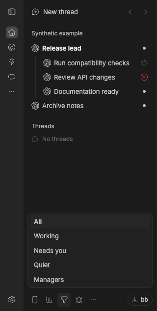

# Responsibilities

Find the BB threads that need you: failures, questions and unread results, including subthreads. Choose **Filter threads → Needs you** in the sidebar footer to work through them. Matching threads keep their parents, and the open thread stays visible; choose **All** to restore the full list.

*Synthetic example data in BB 0.47.1 with Responsibilities and an optional manager configured. The working spinner is BB’s own.*

Filter by **Working**, **Needs you**, **Quiet** or **Managers**. Manager highlighting is optional and uses your own JSON file. **New child thread** opens BB’s composer under the selected thread with **Full Access** selected initially; it preserves any permission mode you choose before sending.

Collapsed parents also show counts of descendants working, waiting for you or failed. Zero counts stay hidden.

Turn on **Compact warm theme** in the plugin settings for warm light/dark colors, 26 px mouse rows, tighter nesting and guides for the selected or hovered path. Touch screens keep larger row targets. Row actions overlay titles instead of reserving space. The theme is off by default; turn it off to restore your selected BB theme while keeping the plugin's marks and filters.

Results count as seen when open in a visible, focused window. Responsibilities stores attention/seen timestamps in local SQLite without changing BB’s native read state. It can also supply unread-result columns to the optional [Subthread Columns](https://github.com/neoromantic/bb-plugin-subthread-columns) plugin.

Requires BB 0.47.1 / SDK 0.6.79 or later, the standard sidebar and full plugin trust. Experimental APIs and sidebar integration may change. Install `git:https://github.com/neoromantic/bb-plugin-responsibilities.git@v0.2.0` in BB. No external service or management registry is required. Adds no telemetry; BB and your chosen provider have their own data handling and access requirements. [README](https://github.com/neoromantic/bb-plugin-responsibilities#readme) · [Migration reference](https://github.com/neoromantic/bb-plugin-subthread-columns/blob/main/MIGRATION.md).
