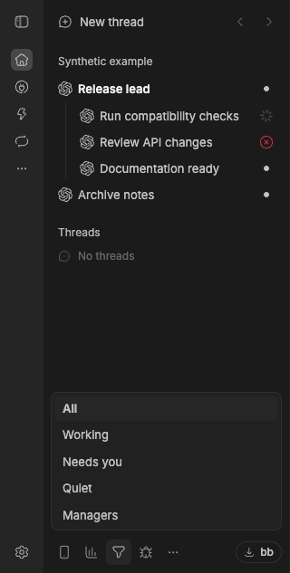
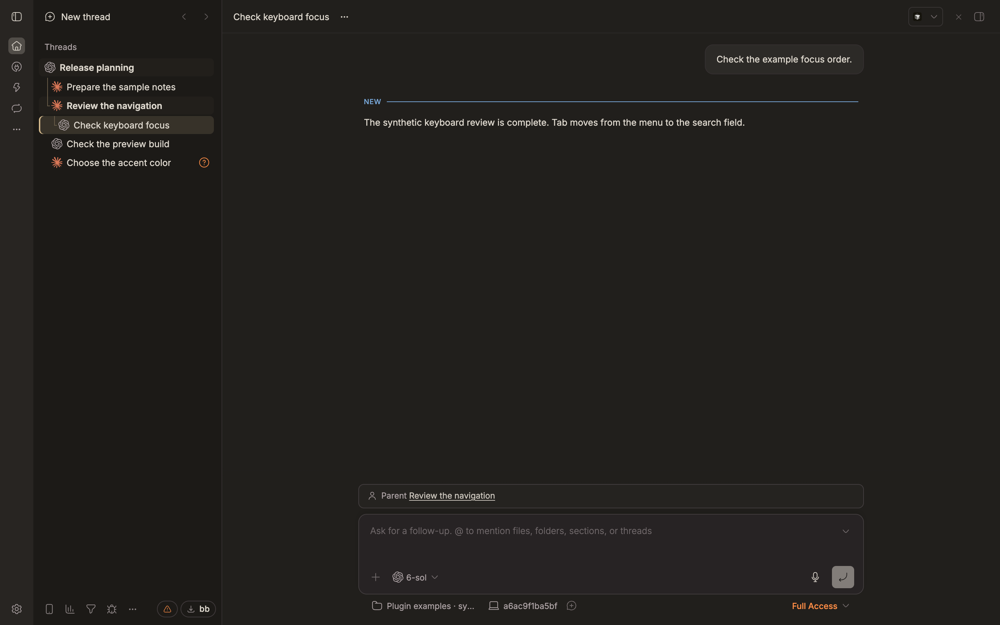
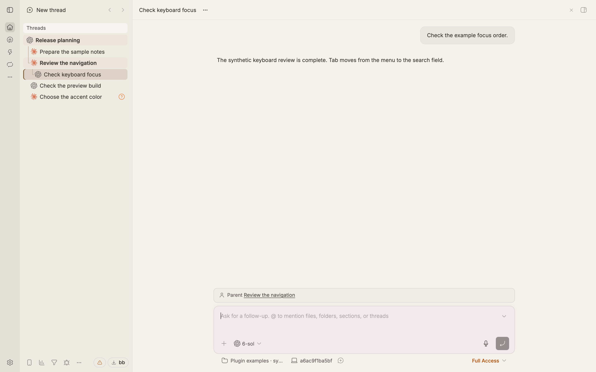
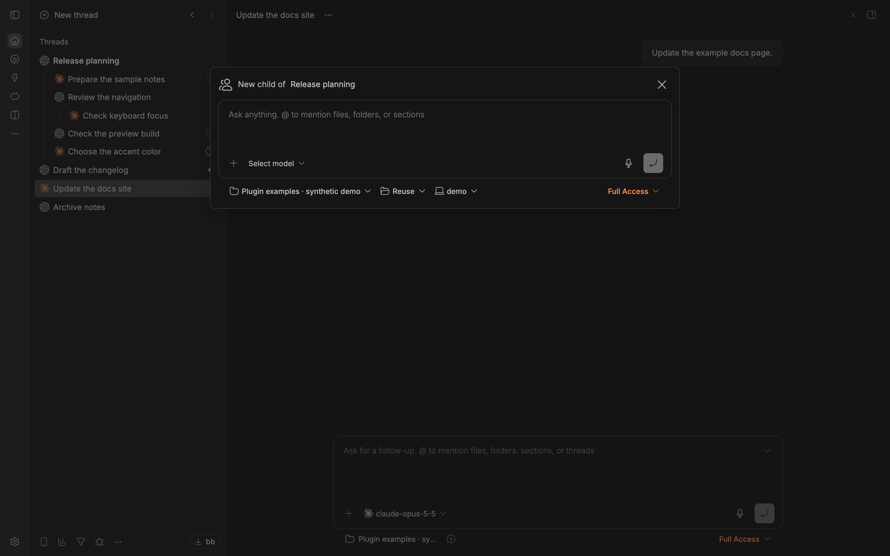

# Responsibilities

Find the BB threads that need your attention, including subthreads. Responsibilities marks failures, questions and unread results, and filters the sidebar so you can work through them. It also adds **New child thread** and optional highlighting for threads you list as managers.



*Synthetic example data in BB 0.47.1 with Responsibilities and an optional manager configured. The working spinner is BB’s own.*

## Install

Requires BB 0.47.1 / SDK 0.6.79 or later with its standard sidebar. The plugin uses experimental BB APIs and internal sidebar attributes; a future BB update or a replacement sidebar may affect it.

Open BB’s **Community Plugins → Responsibilities → Install**, or run `bb plugin install responsibilities`.

For the published 0.2.0 release:

```sh
bb plugin install git:https://github.com/neoromantic/bb-plugin-responsibilities.git@v0.2.0 --yes
```

For a tracking source, use `bb plugin update responsibilities --yes`. To change a pinned version or source, save the plugin settings, remove its registration, install the desired version, then restore those settings individually. Removal resets settings.

To disable or uninstall, use `bb plugin disable responsibilities` or `bb plugin remove responsibilities`.

The plugin's stable ID is `responsibilities`. No external account or service is needed.

Existing users: [migration reference](https://github.com/neoromantic/bb-plugin-subthread-columns/blob/main/MIGRATION.md).

## Try it

1. Choose **Filter threads → Needs you** in the sidebar footer. Open marked threads to read results or answer questions; their parents stay visible so you keep the context. Choose **All** to restore the full list.
2. Open a thread’s actions and choose **New child thread** to start a related task under it. Check the composer’s permission mode before sending: it starts with **Full Access** and keeps any choice you make.

## Marks

On the right of each thread row:

- a red ✕ — the thread failed;
- an amber ? — it waits for your answer or approval;
- a dot — it holds a result you have not seen yet, alone or in the corner of BB's own glyph.

A collapsed parent shows the failure and the dot of its hidden descendants. It also shows counts of descendants **↻ working**, **? waiting for your answer or approval**, and **× failed**, including failed queued messages. Zero counts stay hidden. Counts cover every nested descendant, even when its row is not mounted, and exclude the parent and internal hidden threads. Each thread counts once: waiting takes precedence over failure, then working. Live background jobs keep an otherwise idle thread working. Hover a count for its label; counts fade when the row actions appear.

BB itself marks only top-level threads unread. The plugin also tracks subthreads. A result is the last non-empty assistant message of a finished run. It counts as seen once the thread is open in a visible, focused window. BB's own read state is not changed.

## Filter

The filter button in the sidebar footer narrows the whole list to one kind of thread:

- **All** — no filter;
- **Working** — a turn is running, or a workflow, background agent or background command it started is still alive. A thread waiting for you is not working;
- **Needs you** — the threads with a mark: failed, waiting for your answer, a failed queued message, or an unread result;
- **Quiet** — neither working nor needing you;
- **Managers** — the threads listed in the managers file.

A match keeps its parents, so it stays in its place in the tree. The open thread always stays visible. Your sections and projects without a match hide while the filter is on, collapsed or not. BB's own Pinned and Threads headers stay, and so does a collapsed environment group with the list item around it: BB neither mounts its rows nor names them on screen, so expand it to filter inside. The filter changes no saved order, section or collapse state, and the button turns the accent color while a filter is on. The choice is kept per device. If the button is in **More footer actions**, use **Customize footer** to move it into view.

## Compact warm theme

Turn on **Compact warm theme** in the Responsibilities plugin settings. It is off by default and applies immediately. Turn it off to restore your selected BB theme; filters, attention marks and collapsed counts keep working.

The optional theme adds warm light and dark palettes, 26 px rows with a mouse, and tighter nesting: 10 px per level, then 8 px deeper in the tree. Touch screens keep BB's larger row targets. The selected path gets a subtle background and branch guides; hovering a row also reveals its path. Titles use the available width, with row actions overlaying and fading the text on hover. Manager titles stay semibold with a softer color.





*Synthetic example threads in BB 0.47.1 with Responsibilities 0.2.0. The selected path connects Release planning → Review the navigation → Check keyboard focus. Provider icons are BB's own; Model & Effort Badges is disabled.*

The CSS ships with the plugin, so no BB installation files or separate user stylesheet need editing. It overrides the selected theme while enabled. Model and effort badges remain the responsibility of the separate [Model & Effort Badges](https://github.com/neoromantic/bb-plugin-model-effort-badges) plugin.

## Managers

Set **Managers file** in the plugin settings to an absolute path of a JSON file:

```json
{ "managers": [{ "threadId": "thr_demo_lead" }] }
```

Replace the example ID with your own thread ID. This file is optional; leave the setting empty to turn manager highlighting off. No management service or registry is required. Other fields are ignored. Listed threads get a bold, brighter title and appear under the Managers filter. If such a title starts with `○ `, the row hides that marker; the stored title, tooltip and accessible name keep it. The plugin reloads the list when the file changes.

## New child thread

The thread actions get **New child thread**. It opens BB's own composer and files the new thread under the row's thread, in the same environment, section and pin state. The composer starts with Full Access; pick another permission mode before sending if you want one. This is an initial composer value: the selected mode is passed through when you send, without changing existing threads or project defaults.



*Synthetic example in BB 0.47.1: the composer opened by **New child thread**, before sending. Check the permission mode before submitting.*

## Use with Subthread Columns

Install [Subthread Columns](https://github.com/neoromantic/bb-plugin-subthread-columns) to answer waiting subthreads or inspect failed descendants in one page. Responsibilities also supplies its unread-result columns and shared seen records. Either plugin can be used on its own.

## For other plugins

Other plugins can read the same records through BB's cross-plugin RPC with `pluginId: "responsibilities"`:

- `list({})` returns `[{ threadId, resultAt, quietAttentionAt, seenAt }]`, with epoch milliseconds or null. The read is tagged `attention` and refreshes after every write;
- `seen({ threadId, resultAt })` records that a result was seen. The value only ever grows.

## Data and access

This is a full-trust BB plugin. It reads thread metadata and thread events. It stores result and seen timestamps in its own local SQLite database. It reads the managers file you configure. If an older attention database exists, it imports records from a temporary copy and scans thread history for missed completed results; see the migration reference above. It adds no telemetry or external service calls. BB and your configured providers have their own data handling and telemetry settings. It uses BB’s SDK and SQLite driver plus Zod; React and the composer come from BB. Sending a child thread uses the provider and account you select in BB, with that provider’s normal access requirements and costs.

## Develop

Use Bun 1.4.3 and Node 24. The lockfile pins BB 0.47.1, SDK 0.6.79 and the build tools. BB must be available for `bb plugin build`; `bun run build` uses the pinned local CLI.

```sh
bun install --frozen-lockfile
bun run check
bun test
bun run build
```

Build output is generated in `dist/`; the npm allowlist includes runtime sources and prebuilt bundles, without source maps or tests. The same build on a clean frozen-lock install must produce identical bundle bytes.

See [demo provenance](assets/README.md). MIT licensed; see THIRD_PARTY_NOTICES for Zod attribution.
